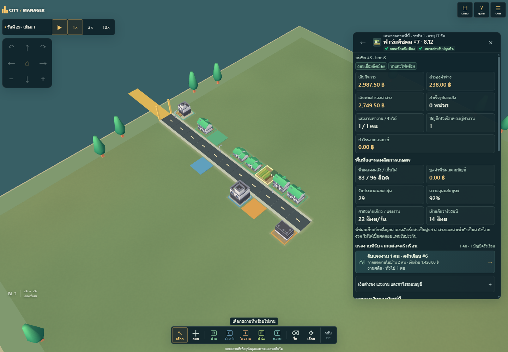
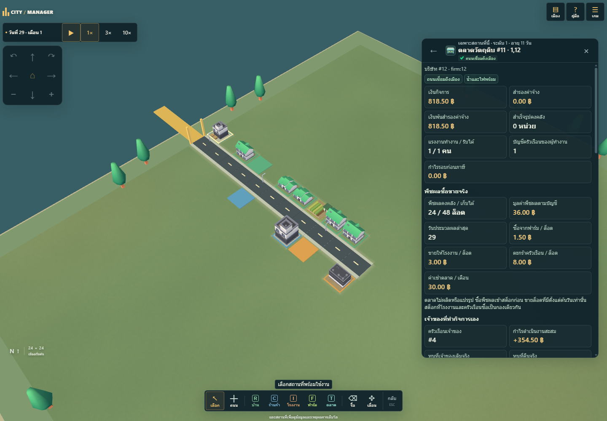
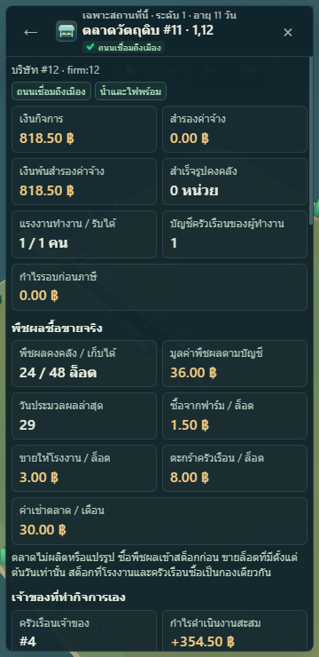

# Agriculture candidate: ภาพและผลตรวจ

ยังไม่ Merge หรือเผยแพร่ ชุดนี้เพิ่มฟาร์ม ตลาดวัตถุดิบ และการใช้พืชผลจริงในโรงงาน โดยคง GUI ที่เผยแพร่แล้ว งานออกแบบ inspector ให้ต่างกันตามประเภทอาคารอยู่รุ่นถัดไป

ตรวจ production build ใน Microsoft Edge ที่ติดตั้งบน Windows: **62 กลุ่มปกติ + 62 กลุ่ม fallback** ผ่าน และรายงานสัญญาณ/คำถามท้องถิ่น/offline gate อีก **6+6+5 กลุ่ม** ผ่าน ใช้ mock/offline ไม่มีการเรียก provider จริง พร้อม **171 unit tests, 16 advisor offline tests, asset verification และ strict TypeScript/build** ผ่าน ดูเวลาและ hashes ใน [qa.json](qa.json) และ exact final-head CI ใน PR

ภาพด้านล่างมาจากเมือง seed 61025 วันที่ 29 ซึ่งเดิน simulation จริงจนเกิดทั้งฟาร์ม→ตลาด→โรงงาน→ร้านค้า→ครัวเรือน และตลาด→ครัวเรือน ไม่มีการใส่ยอดจำลองใน UI ภาพมือถือเป็น viewport/touch emulation 360×740 ไม่ใช่ Galaxy S22 เครื่องจริง

## ฟาร์ม

ความอุดมสมบูรณ์ที่บันทึกตาม seed ผลผลิต แรงงาน และสต็อกจาก state จริง

## ตลาดของครัวเรือน

พืชผลหนึ่งกองสำหรับทั้งผู้ซื้อโรงงานและครัวเรือน แยกเงินกิจการจากเงินครัวเรือน มีต้นทุนสต็อกและกำไรที่เกิดจากการขายจริง

## แผงมือถือ

แผงสูงเมื่อเปิดข้อมูล มี Back/ปิด กล้องหยุดรับ input ใต้เมนู และทดสอบทั้ง portrait, landscape และ layout 980 บน screen 390

ข้อจำกัด: หนึ่งพืชผล ราคาคงที่ การค้าทันทีเมื่อเชื่อมประตูเมือง ไม่มีระบบรถขนส่ง/เหมือง/ตลาดลงทุนหรือบัญชีสินทรัพย์ครบรูปแบบ ตัวเลขเป็นสมมติฐานเกม ดู [กติกา](../AGRICULTURE.md) และ [การย้ายเซฟ](../AGRICULTURE-SAVES.md)
