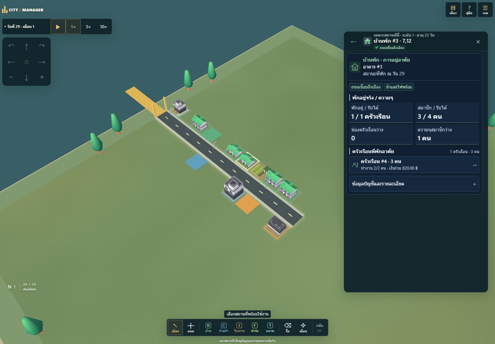
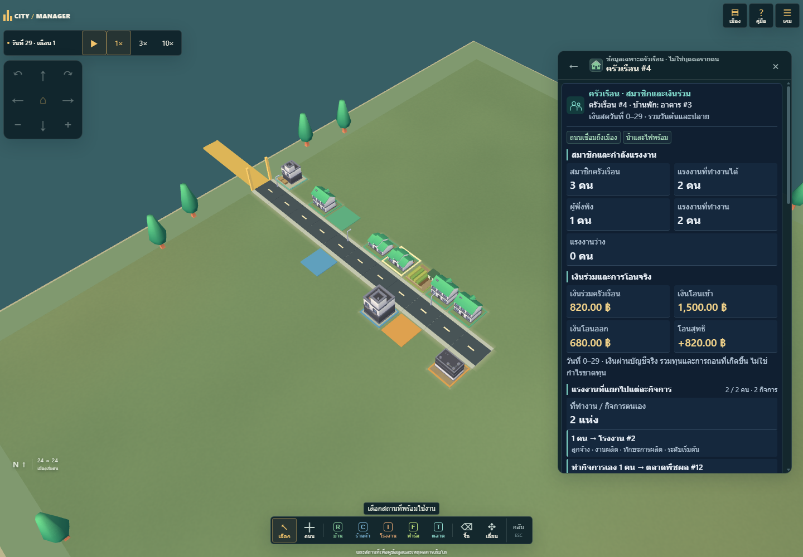
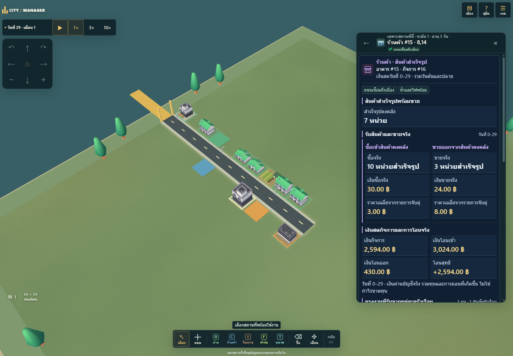
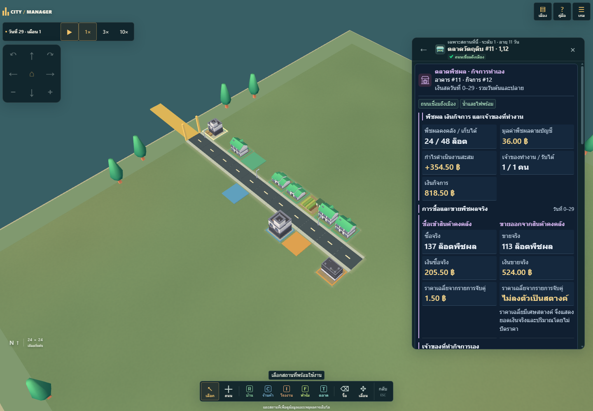
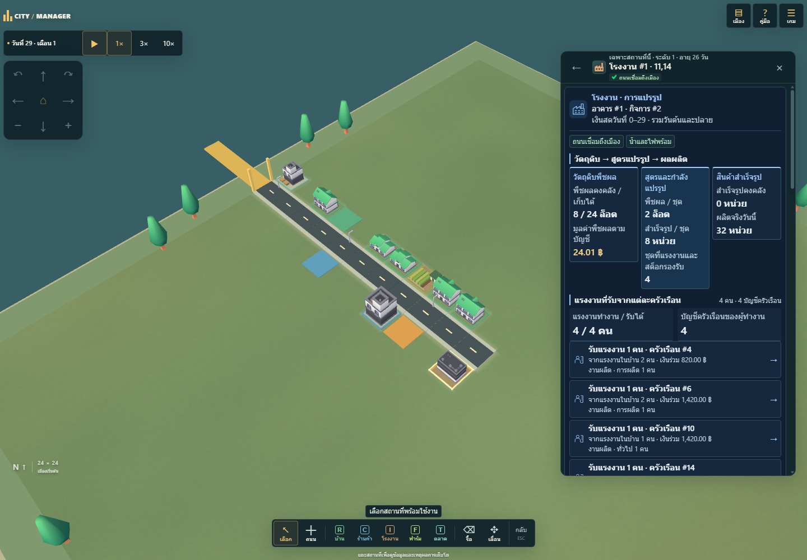
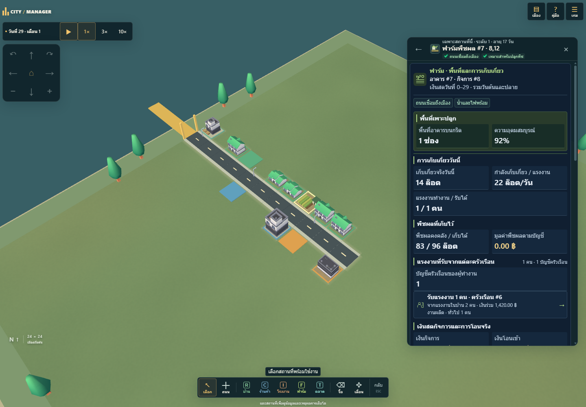
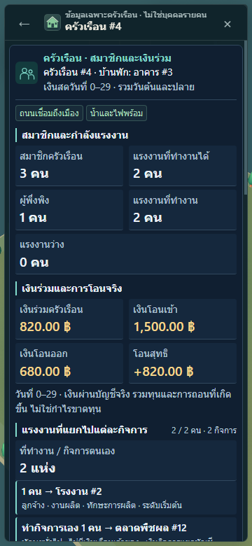
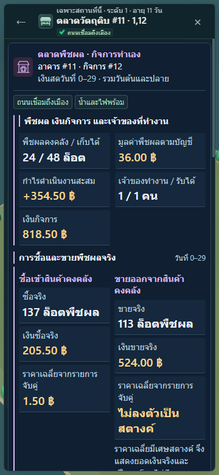

# การ์ดสถานที่: preview ที่ยังไม่เผยแพร่

ต่อจากเกษตร [PR #12](https://github.com/nustanakritwithai/CityManager/pull/12) โดยเปลี่ยนเฉพาะการแสดงผล ดู [กติกาการอ่านการ์ด](../BUILDING-CARDS.md) และ [ผลตรวจ/เวลา/hashes](qa.json) ภาพเป็นเมือง seed 61025 วันที่ 29 ที่เกิดจากการเดิน simulation จริง ไม่มีการใส่ตัวเลขตัวอย่างในหน้าจอ

ตรวจใน Microsoft Edge ที่ติดตั้งบน Windows: 180 unit tests, 16 advisor offline tests, assets และ strict TypeScript/build ผ่าน ตรวจเบราว์เซอร์ 69 กลุ่ม normal + 69 fallback และ signal/facts/offline อีก 17 กลุ่ม ไม่มี provider call จริง ป้ายรหัสและข้อความสถานะราคาชุดสุดท้ายทวน layout/native controls อีก 24 กลุ่ม ผล exact-head CI ครบชุดอยู่ใน PR

## บ้านและครัวเรือน

บ้านแสดงการพักอยู่จริง/ความจุ และครัวเรือนของบ้านนั้น แตะครัวเรือนเพื่อดูสมาชิก เงินร่วม และแรงงานที่ทำงานแยกกิจการ ไม่เรียกเงินผู้อาศัยว่ามูลค่าอาคาร

## ร้านค้าและตลาด

ร้านค้าแยกสินค้าสำเร็จรูปกับฝั่งซื้อ/ขาย ตลาดแสดงพืชผล ต้นทุน กำไร และแรงงานเจ้าของ รหัสอาคารกับกิจการระบุแยกกัน ราคาเฉลี่ยไม่ลงตัวเป็นสตางค์ไม่ถูกแทนด้วยราคาที่แต่งขึ้น

## โรงงานและฟาร์ม

โรงงานเรียงวัตถุดิบ → สูตร/กำลังแปรรูป → ผลิตจริง ฟาร์มแยกพื้นที่หนึ่งช่อง ความอุดมสมบูรณ์ ผลเก็บเกี่ยวจริง และกำลังต่อแรงงาน

## ตัวอย่างมือถือ

ทดสอบ portrait 360×780, landscape 844×390 และ layout 980 บน screen 390 แผงเปิดสูงและเลื่อนได้ พร้อม Back/ปิดและกล้องที่ไม่รับ gesture ใต้เมนู เป็น viewport/touch emulation ไม่ใช่ Galaxy S22 เครื่องจริง

ข้อมูลรองเดิมอยู่ครบและเปิดด้วย native disclosure ได้ ตัวจำลอง เศรษฐกิจ save v4 และบริการสัญญาณไม่ได้เปลี่ยน ไม่มี GDP ประชากรตัวอย่าง หรือกราฟประวัติที่ระบบไม่เก็บ
