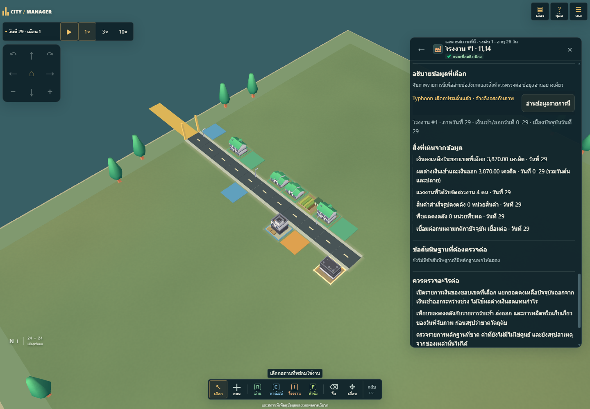
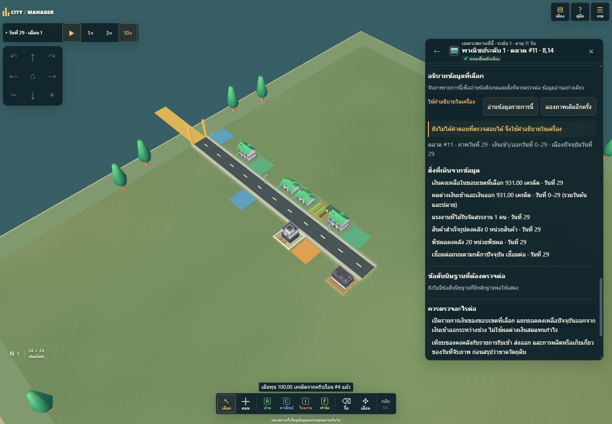
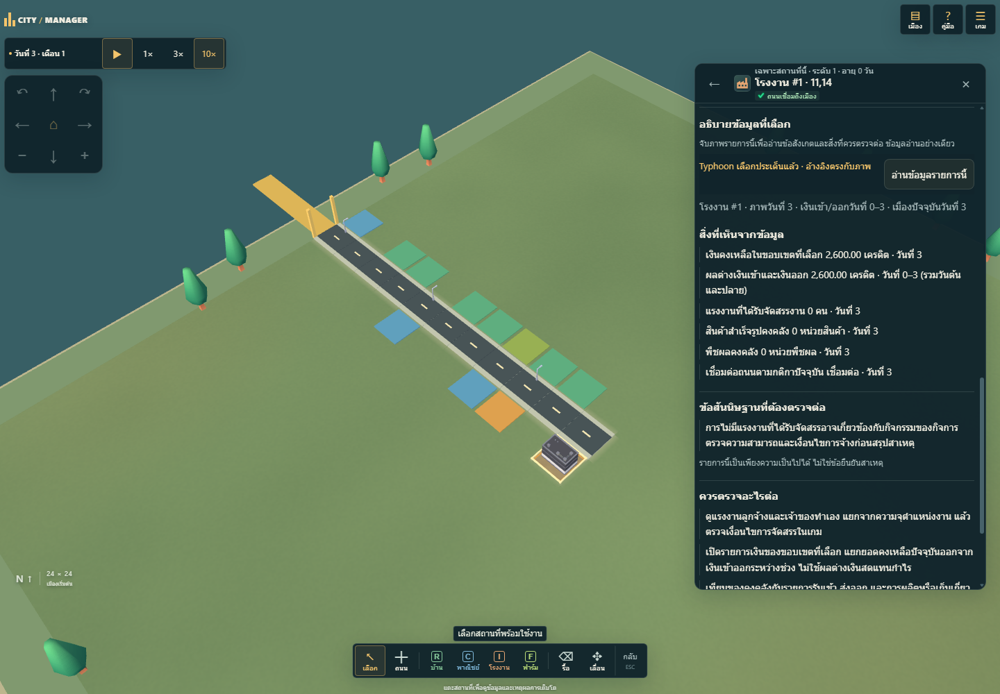
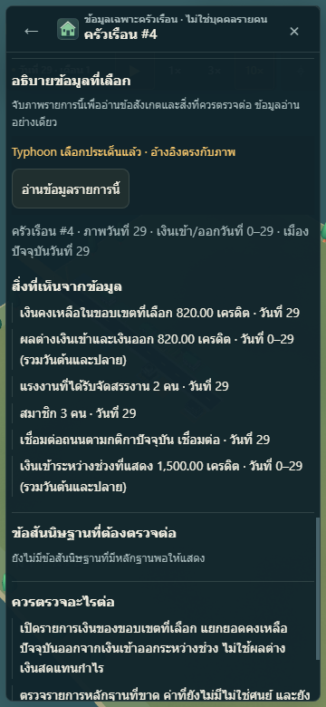
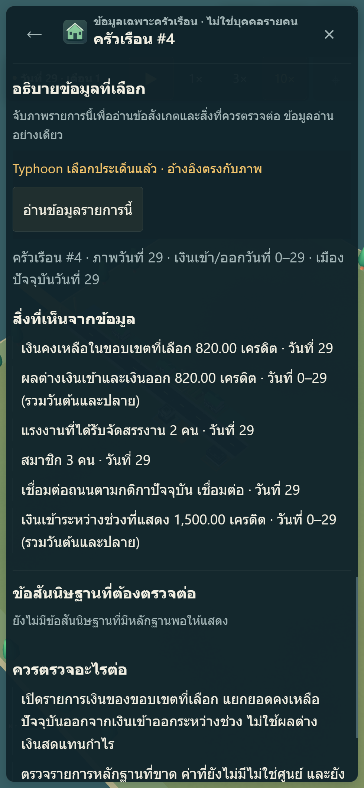

# Selected-entity inspector previews

Local preview of source `e79c25134939162a2f4bbf525d4ef341e085580f`, rebased on commercial-L1/save-v5 main `8fd3367ad2cf387e2d3fc3134e9b4d69409800dd`, using synthetic game data and intercepted mock responses only. No provider request, credential use or production activation occurred. The displayed Typhoon state exercises the future validated-response UI; production entity transmission defaults to disabled. The later evidence commit changes only documentation and preview files.

Installed Edge passed 7 acceptance groups with 14 mock entity requests, 0 real API requests and 0 browser errors. Normal 360×780 and wide 980×2120/screen 360 are phone/touch emulation, not a physical Galaxy S22. Essential type is 14 reader units, controls 44px, without horizontal overflow. Market fallback now shows the actual commercial level-one label. See [QA metadata](qa.json), [contract](../ENTITY-EXPLANATION-CONTRACT.md) and [activation review](../ENTITY-EXPLANATION-ACTIVATION.md).

## Building explanation

## Fallback and insufficient evidence

## Household on phone layouts

