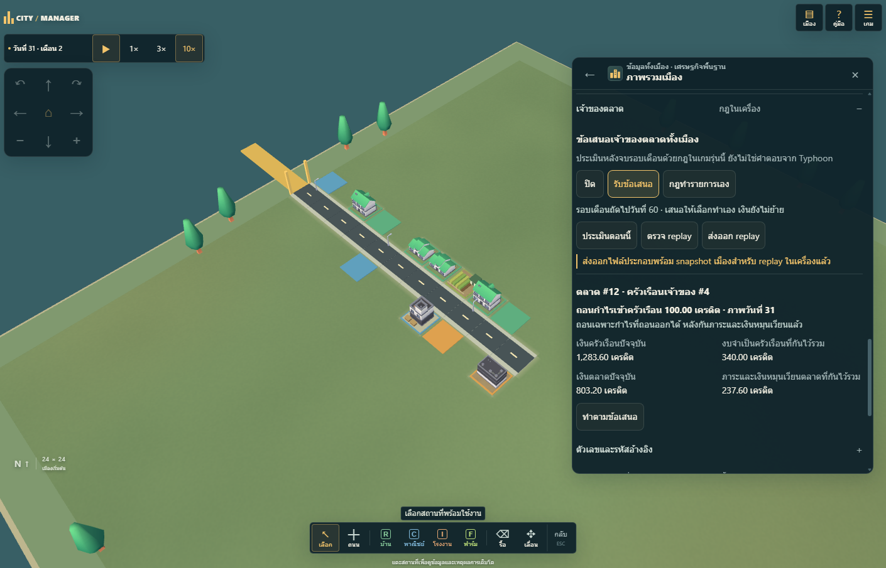
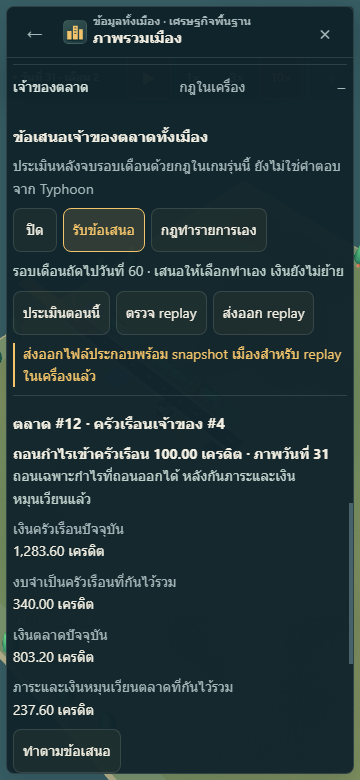
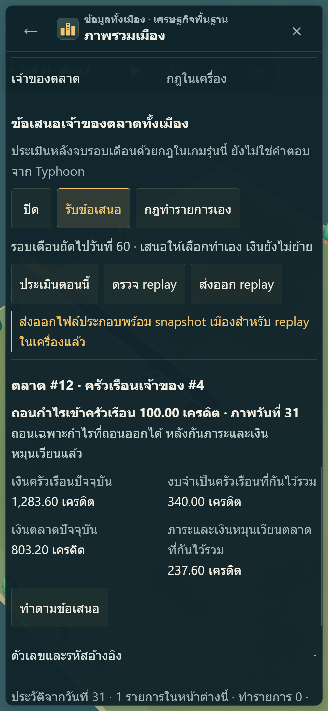

# Owner-rule inspector previews

Actual local rule execution from source `96302c1bf15887942ee05fe0ea7e1e719e56b987`, using synthetic save-v6 fixtures. This feature does not call Typhoon. All provider/report routes were blocked during the browser run: six acceptance groups passed with zero API calls or browser errors.

The suite uses real controls for manual acceptance, stale/duplicate protection, monthly off/proposal/auto modes, load reset, a drag-built road journal boundary, replay verification and sidecar download. The later preview commit changes only documentation/images.

Phone layouts are Edge viewport/touch emulation, not a physical Galaxy S22. Essential Thai text is at least 14 physical pixels, controls 44px, with no horizontal overflow. [QA metadata](qa.json) · [Rules and retention](../OWNER-DECISIONS.md) · [720-day/four-seed summary](../owner-decision-benchmark.json).

