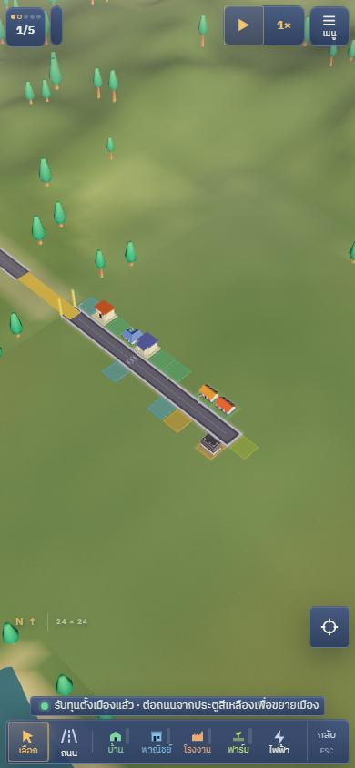
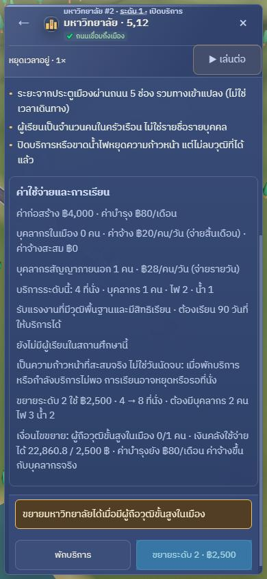

# Player feedback UX: draft validation

This patch adds visible school/university models, inline campus action results,
education costs and actual cohort progress, inspector pause/play controls, and a
persistent save-failure banner. It does not change education rules, prices,
payroll, simulation timing, or save storage/authority. Main `a6f4ada` is integrated,
including the Load identity fence and workforce fixes.

## Verified

- TypeScript: `node node_modules/typescript/bin/tsc --noEmit` passed.
- Production build: `node node_modules/vite/bin/vite.js build --configLoader native`
  passed (existing large-bundle warning remains).
- Targeted tests: 18/18 passed with
  `node --experimental-strip-types --test tests/player-feedback.test.ts tests/autosave.test.ts tests/scene-decor.test.ts tests/load-authority.test.ts tests/education-labor.test.ts`.
- Isolated Edge/CDP, CSS viewport 390 x 844, DPR 1, synthetic starter city:
  school and university appear on the map; tapping the university selects it;
  the upgrade shows its actual 2,500 baht price; repeated refusal remains visible
  beside the actions. The revised layout gives the refusal a full row instead of
  squeezing the two action buttons. Screenshots below were visually inspected.
  They precede the final read-only capacity row, which now distinguishes maximum
  seats from `report.operatingSeats`, enrolled learners and today's progressing
  learners. That row consumes the simulator report directly, including partial
  capacity when available; it does not implement its own staffing policy.
- No real player saves, personal browser profile, server identity or shared market
  transactions were used. No new dependencies or external assets were installed.

## Still blocked; not a full UI pass

The executor repeatedly disconnected during the remaining runtime flow. CDP
reported `Input.dispatchTouchEvent` and later `Runtime.evaluate` timeouts, followed
by `exec-server transport disconnected`. This does not establish a product defect
or a successful test. A later clock attempt used pointer clicks at the mobile
viewport; it also did not finish. No physical Android test was performed.

Before merge, complete inspector pause/play, actual school progress/cost and
successful action feedback, manual/autosave failure persistence through panel/tool
changes, export reachability, and clearing the warning only after a successful
write. Inspect desktop layout at 1280 x 900 as well. The pure controller tests
cover pending and overlapping saves, but do not replace these browser checks.

The bounded `tests/player-feedback-smoke.mjs` uses an explicitly supplied isolated
browser (`CITYMANAGER_DEBUG_PORT`) and serves the local `dist` build. It seeds only
the synthetic localhost origin and injects quota failures locally. Set
`CITYMANAGER_UX_RUNTIME_ONLY=1` to skip the already-confirmed campus flow and resume
the remaining clock/save checks. Successful completion writes `results.json`;
no successful full-run result has been produced for this draft.

## Targeted CI follow-up

`.github/workflows/player-feedback.yml` runs the full smoke on Windows with the
installed Edge, a fresh profile, loopback CDP port 9476, and the local test server
on port 4176. It builds with online APIs disabled and retains JPG screenshots plus
`results.json` for three days even on failure. It includes desktop campus and
active-warning screenshots, not only the final game panel.

The first existing browser CI on `55b0dacb` found a real navigation regression:
after a quota failure, the independently fixed mobile page menu stayed behind
the persistent banner even though its HUD parent moved down. The follow-up uses
the shared touch-row origin to move the menu, clock and KPI chip together. The
new smoke explicitly checks the game-menu hit target while the warning remains.
This diagnosis is separate from the earlier local executor disconnections; CI
must confirm the fix before release.
