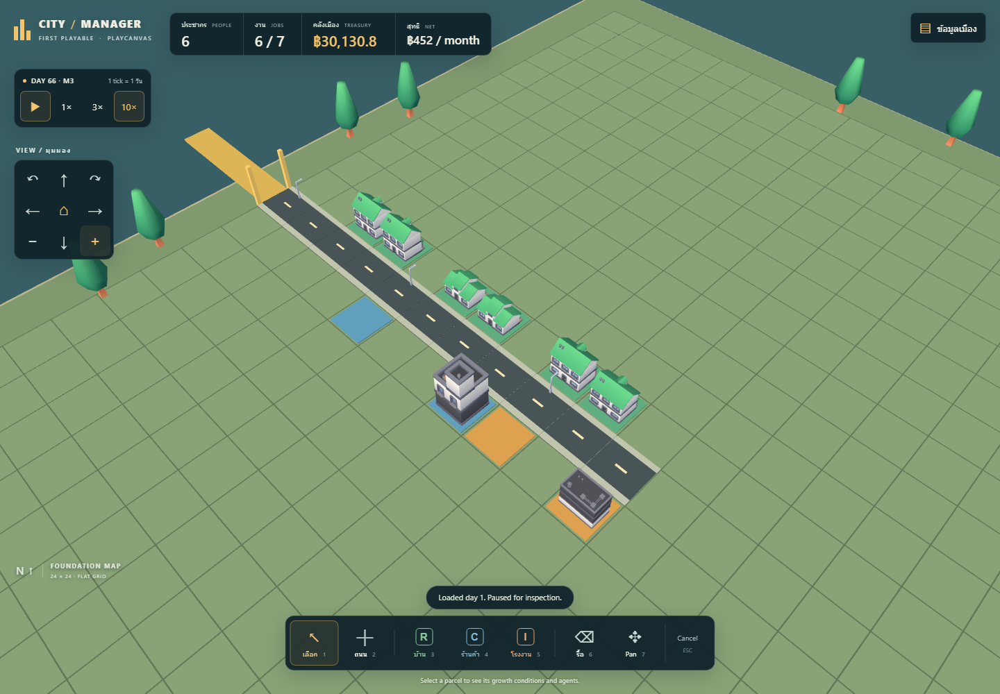

# Visual preview: Kenney city models

Review branch `feat/stylized-city-assets`; no merge or deployment requested for this visual change. Public `main` remains the previously released prototype. Original code and procedural fallback are retained; `src/sim.ts` and its tests are unchanged.

The preview adds six low-poly buildings, one tree and one streetlight from four official Kenney CC0 packs. Runtime GLBs total **568,696 bytes / 8,563 unique-file triangles**, with embedded palettes and shared model resources. Roads gain curbs and directional markings; colors, light, framing and mobile toolbar spacing are adjusted. See [asset sources, licenses and reproduction](../ASSETS.md).

## Inspected screenshots

| View | Released procedural version | Visual branch |
|---|---|---|
| Desktop | [Before](before-desktop.png) | [After](after-desktop.png) |
| Mobile viewport | [Before](before-mobile.png) | [After](after-mobile.png) |

The before images are retained from release `3e629fd06fa31162241533719344b7cf4ab1c803`. After images were captured from the built preview in installed **Microsoft Edge 155.0.4283.62**, then opened and visually inspected. The camera framing changes intentionally; these are presentation comparisons, not pixel-identical benchmark scenes. The mobile capture is an emulated 390×844 viewport at DPR2, not real-device mobile QA.

## Verification

- `npm test`: **11 passed**, including deterministic replay/save continuation, economic journals, disconnection and demolition.
- `npm run assets:verify`: **passed**, all 12 payload hashes/CC0 licenses and the manifest/receipt/lock agree.
- `npm run build`: **passed**, TypeScript and Vite `/CityManager/` output. JS 1,176.40 kB / 314.76 kB gzip, CSS 13.46 kB. The existing Vite >500 kB chunk warning remains; no mobile GPU performance claim is made.
- Normal `npm run test:browser`: **12 groups passed**, eight models loaded, no runtime or console errors. [Machine-readable result](browser-models.json), 2026-10-23 22:38 UTC.
- `CITYMANAGER_BLOCK_MODELS=1 npm run test:browser`: **12 groups passed** with all eight GLB requests intentionally failed. [Result](browser-fallback.json), 2026-10-23 22:36 UTC. The eight expected PlayCanvas network-error messages are recorded separately; no unexpected errors occurred. [Procedural fallback screenshot](fallback-desktop.png) was opened and inspected.
- Independent static/integrity review: no blocking findings. `git diff --check`: passed.

Browser checks retain real pointer road drawing, repeated tools, Escape during drag, R/C/I zoning, bulldoze, disconnected explanation, exact save/load, purchases/wages, pan/rotate/zoom, summary keyboard behavior, >=44 CSS-pixel buttons and multi-touch cancellation. Construction tests zoom out through actual controls and assert that gesture endpoints hit the canvas, so HUD occlusion cannot silently pass.

CI runs normal and blocked-model acceptance against the exact PR source. The branch is a preview pending review; this document does not claim a public visual deployment. The optional game-dev CLI was unavailable; checks use pinned glTF Transform and project integrity scripts, not formal Khronos certification. Cross-browser and real-device performance testing remain future work.
